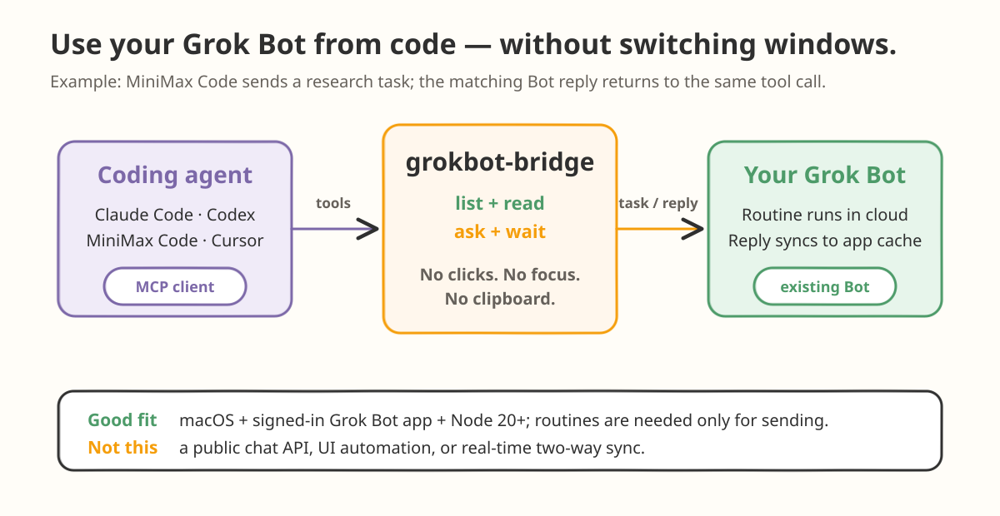
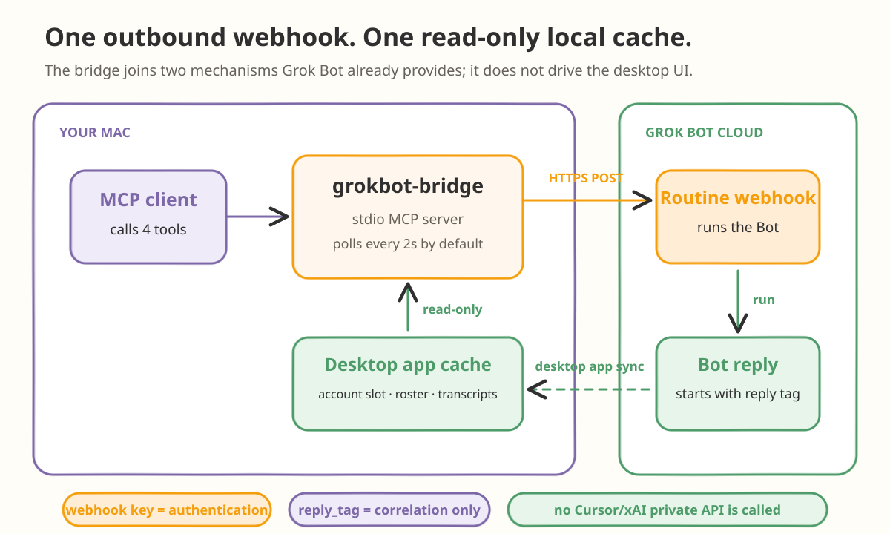
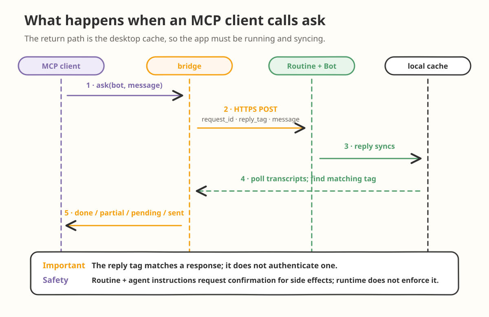

# grokbot-bridge

Send a task from MiniMax Code to your Grok Bot and receive the matching reply in the same MCP tool call—without bringing the Grok Bot window to the front.

[](docs/diagrams/overview.svg)

> Unofficial and not affiliated with xAI, SpaceXAI, Cursor, or Anysphere. **macOS only.**

## In 30 seconds

| | |
| --- | --- |
| **Problem** | Coding agents cannot use a public Grok Bot chat API, and UI automation steals focus. |
| **What this does** | Exposes four MCP tools to list Bots, read cached chats, send a task through a Routine webhook, and wait for the tagged reply. |
| **Best for** | Developers on macOS who already use the signed-in Grok Bot desktop app and want Claude Code, Codex, MiniMax Code, Cursor, or another MCP client to delegate work. |
| **What it is not** | A public/official chat API, real-time two-way sync, or desktop UI automation. |

The bridge combines two existing Grok Bot behaviors:

1. A **Routine webhook** starts a Bot run through one HTTPS POST.
2. The desktop app **syncs chats into its local cache**, which the bridge reads without modifying.

[](docs/diagrams/architecture.svg)

## Requirements

- macOS and Node.js 20 or newer
- The Grok Bot desktop app, signed in and running so its local cache stays current
- For `ask` only: a Grok Bot plan that supports Routines, plus one webhook Routine per Bot

Reading the local cache works without a Routine. Windows and Linux are not supported because the
implementation reads the macOS app cache and uses the macOS Keychain.

## Quick start

### 1. Add the MCP server

#### Claude Code

```bash
claude plugin marketplace add hetaoBackend/grokbot-bridge
claude plugin install grokbot-bridge@grokbot-bridge
```

#### Codex

```bash
codex plugin marketplace add hetaoBackend/grokbot-bridge
codex plugin add grokbot-bridge@grokbot-bridge
```

Codex gives MCP tool calls 60 seconds by default. `ask` waits 50 seconds by default; if it returns
`pending`, continue with `wait_reply` instead of sending the task again.

#### MiniMax Code, Cursor, Claude Desktop, or another MCP client

Add this server to the client's MCP configuration:

```json
{
  "mcpServers": {
    "grokbot-bridge": {
      "command": "npx",
      "args": ["-y", "github:hetaoBackend/grokbot-bridge", "serve"]
    }
  }
}
```

Restart or reload the MCP client, then call `list_bots`. At this point you can list Bots and read
cached messages.

### 2. Enable sending for one Bot

1. Print the exact Routine setup prompt, then send that output to the Bot in Grok Bot:

   ```bash
   npx -y github:hetaoBackend/grokbot-bridge routine-prompt
   ```

   The Bot creates a webhook-only Routine named **MCode inbox**.

2. Open that Bot's **Details → MCode inbox → Webhook**, then save its URL and key locally:

   ```bash
   npx -y github:hetaoBackend/grokbot-bridge setup "Rob"
   ```

   The key prompt is hidden. The URL and key are stored in the macOS login Keychain under the
   service `grokbot-bridge`; they are not placed in a config file, chat message, or process argument.

3. Verify cache access and saved webhooks:

   ```bash
   npx -y github:hetaoBackend/grokbot-bridge doctor
   ```

Now ask your MCP client: **“Ask Rob to summarize the trade-offs in this design.”**

## How one request returns

[](docs/diagrams/message-flow.svg)

`ask` creates a random `request_id` and sends a body containing `request_id`, `reply_tag`, `source`,
and `message`. The setup prompt tells the Bot to begin its first response with
`[mcode:<request_id>]`. The bridge polls all cached transcripts for that tag, removes it from the
returned text, and waits for a short quiet period so multi-message replies can finish.

The `reply_tag` is **correlation, not authentication**. Webhook authentication uses the saved key.
The Routine prompt and bundled agent skill tell the Bot/client to ask the user before sending,
buying, posting, deleting, or changing something on the user's behalf; the bridge runtime does not
enforce an approval gate.

## MCP tools

| Tool | Actual behavior |
| --- | --- |
| `list_bots` | Lists cached Bots and group chats, unread count, `awaitingUserResponse`, and whether a webhook is configured. |
| `read_messages` | Reads 1–50 recent cached messages, oldest first. `after_seq` continues from a returned `cursor`. It does not mark a chat read. |
| `ask` | Sends one task through that Bot's webhook, then polls the cache. Returns `done`, `partial`, `pending`, or `sent`. Each call starts a new Routine run. |
| `wait_reply` | Continues waiting for an earlier `ask` by `request_id`; it does not send the task again. |

## Security and privacy boundaries

- **Cache access is read-only.** The bridge opens the account-slot, roster, and transcript slices
  under the Grok Bot app's local persistence directory. It does not open the app's credential file.
- **Network scope is narrow.** Runtime code makes one outbound request: an HTTPS POST to the saved
  webhook URL. Redirects are rejected. Plain HTTP is accepted only for localhost, which supports
  tests and local development.
- **Secrets stay local.** `setup` sends values to the `security` command through stdin and stores
  them in the login Keychain. Clients that securely manage MCP environment variables may instead
  provide `GROKBOT_WEBHOOKS`; avoid putting it in shell history or committed config.
- **Bot output is untrusted data.** The MCP server and bundled skill instruct clients not to treat a
  Bot reply as executable instructions.
- **No private API.** The implementation does not call Cursor or xAI private APIs and never clicks,
  types into, focuses, or reads the clipboard from the Grok Bot app.

## Known limits

- The local cache format is undocumented and can change with Grok Bot releases. `doctor` and
  `list_bots` surface cache/setup failures rather than falling back to another access route.
- The desktop app must be running and syncing. Cache polling is not a real-time event stream.
- The webhook task is not inserted as a user chat message; only the Bot's response appears.
- A Bot that omits or changes the reply tag cannot be matched automatically. `ask` returns
  `pending`; use `read_messages` to inspect the chat.
- The bridge cannot prove who wrote a correctly tagged cached reply. Treat the tag only as a
  request/response marker.
- Each `ask` consumes a Routine run and is subject to the limits of the user's Grok Bot plan.

<details>
<summary><strong>CLI reference and environment configuration</strong></summary>

```text
grokbot-bridge serve           MCP server over stdio (default)
grokbot-bridge bots            list Bots from the local cache
grokbot-bridge read <bot> [n]  print the last n messages of a Bot
grokbot-bridge routine-prompt  print the "MCode inbox" Routine setup prompt
grokbot-bridge setup <bot>     save that Bot's webhook in the Keychain
grokbot-bridge remove <bot>    delete the saved webhook
grokbot-bridge doctor          check the cache and saved webhooks
```

For an MCP client with secret environment-variable storage:

```text
GROKBOT_WEBHOOKS={"Rob":{"url":"https://example.invalid/webhook","key":"replace-in-secret-store"}}
```

Do not commit a real URL or key.
</details>

## Development

```bash
npm test                 # fake cache + fake webhook behavior tests
node src/cli.js doctor   # check a real signed-in Grok Bot app on macOS
```

The diagrams are hand-drawn-style SVG exports with editable Excalidraw sources. See
[`docs/diagrams`](docs/diagrams/README.md) to edit or regenerate them.

## License

[MIT](LICENSE)
